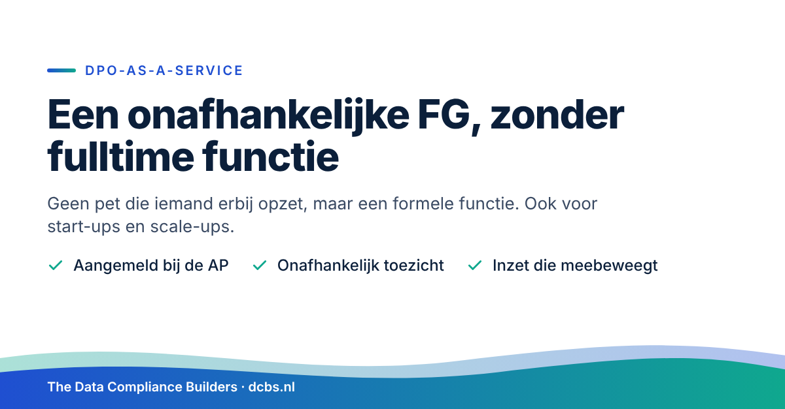

A good DPO prevents more problems than he solves. The real value of a Data Protection Officer is not in putting out fires, but in looking over your shoulder before something goes wrong.

With a new system, a new supplier or a new use of AI. At the moment when a choice is still easy to adjust. Repairing afterwards is always more expensive.

A DPO also gives you something that is hard to organise yourself: an independent view. Your board knows where the risks are, in black and white. In a data breach there is calm, because someone knows what needs to happen. And towards customers, investors and the Dutch Data Protection Authority (AP) you have a strong story.

Most organisations do not need a full-time DPO. With DPO-as-a-Service you get an experienced, independent DPO who knows your organisation, for the capacity that suits you.

## What does a DPO do?

The DPO, in Dutch the Functionaris Gegevensbescherming (FG), oversees compliance with the GDPR. He advises on privacy questions and is the point of contact for the AP, your employees and the people whose data you process.

The DPO does not carry final responsibility. That responsibility stays with your organisation. The DPO makes sure you take decisions well informed and points out risks you would otherwise miss.

The DPO does not do the operational work either. Keeping the record of processing up to date, handling data subject requests and recording data breaches is the task of the privacy officer. The DPO checks whether that is done properly.

And the role is purely about privacy. Information security, NIS2 and ISO 27001 are not part of it. Those subjects touch each other, but they are separate disciplines with their own responsibilities.

## When is a DPO mandatory?

The GDPR requires a DPO in three situations:

1. You are a public authority or public body
2. Your core activity consists of systematically monitoring people on a large scale, for example through tracking or profiling
3. Your core activity consists of processing special categories of personal data on a large scale, such as health data, or criminal data

If this applies to you, you register the DPO with the AP.

Many organisations fall just outside this. Think of a SaaS company with customer data, a smaller care provider or a business services firm. The GDPR still applies in full, and there is privacy work to do. For that you need a privacy officer. A DPO is then not mandatory, but can be a deliberate choice.

## Start-up or scale-up? Choose a DPO deliberately from the start

Are you building a product in which personal data plays a major role? Think of healthtech, HR tech, fintech or a SaaS platform. Then it can be smart to appoint a DPO straight away, even if it is not yet required.

Privacy that you include from the start is much cheaper than privacy you have to build in afterwards. The GDPR calls that privacy by design. A DPO who looks at product choices with you prevents you from having to rebuild features or throw away data later.

In addition, investors and business customers increasingly ask how you have arranged privacy. In a funding round, a due diligence or a tender you want to have that answer ready.

And if your organisation grows quickly, the obligation sometimes grows with it. If you start processing health data on a large scale, a DPO becomes mandatory. Then you are already prepared.

## Why an external DPO?

Most organisations with 50 to 250 employees do not need a full-time DPO. Recruiting a good DPO is also difficult and expensive. An external DPO has a few clear advantages.

**Independence.** The GDPR requires the DPO to work independently and to have no conflict of interest. An employee who is also IT manager, lawyer or board member quickly runs into trouble there. An external DPO stands apart from your line organisation.

**Experience.** An external DPO sees many different organisations and situations, and brings that knowledge along.

**Flexibility.** You pay for the capacity you need. With a new system or an audit you scale up temporarily, and down again afterwards.

**Continuity.** No gap in case of illness, leave or departure.

## What do you get in concrete terms?

1. A formally designated DPO, registered with the AP
2. A fixed point of contact for the AP, your employees and data subjects
3. Independent oversight of compliance with the GDPR, with an annual report to the board
4. Advice on DPIAs and new processing activities
5. Advice on data breaches: do you need to notify, and is the handling in order?
6. Oversight of the record of processing and the handling of data subject requests
7. Awareness and training of employees

The operational work is done by a privacy officer. That can be someone from your own organisation. If you do not have the capacity for that, it can also be done through Privacy Officer as a Service. But always by someone other than the DPO, so that the oversight remains independent.

## How we work

We start with a short exploration. Where do you stand, what is already in place and where are the biggest risks? After that you receive a concrete proposal with a fixed monthly capacity.

In the first months we check whether the basics are in place: register, policy and a way of working for data breaches and requests. After that the focus is on oversight, advice on new projects and periodic checks.

## Three questions to ask yourself

1. Are you required to appoint a DPO, and have you done so?
2. Can your DPO really provide independent oversight, separate from the decisions he takes himself?
3. Is it clear who does the operational privacy work, and who oversees it?

Is the answer to one of these questions no or "I am not sure"? Then it is a good idea to talk.

## Get in touch

Do you want to know what DPO-as-a-Service can mean for your organisation? Book an intro call without obligation. Email [contact@dcbs.nl](mailto:contact@dcbs.nl) or call +31 6 15234409. Then we look together at what you need, and what you do not.

