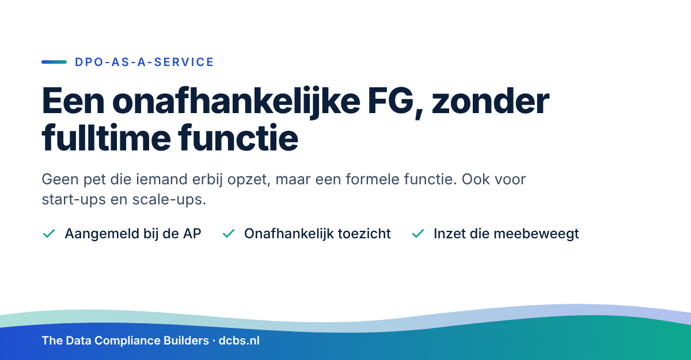

Een goede FG voorkomt meer problemen dan hij oplost. De echte waarde van een Functionaris Gegevensbescherming zit niet in het blussen van branden, maar in het meekijken voordat er iets misgaat.

Bij een nieuw systeem, een nieuwe leverancier of een nieuwe toepassing van AI. Op het moment dat een keuze nog makkelijk bij te sturen is. Achteraf repareren is altijd duurder.

Een FG levert je ook iets op dat je zelf moeilijk kunt organiseren: een onafhankelijke blik. Je directie weet waar de risico's zitten, zwart op wit. Bij een datalek is er rust, omdat iemand weet wat er moet gebeuren. En richting klanten, investeerders en de Autoriteit Persoonsgegevens heb je een sterk verhaal.

Voor de meeste organisaties is een fulltime FG niet nodig. Met DPO-as-a-Service krijg je een ervaren, onafhankelijke FG die je organisatie kent, voor de inzet die bij je past.

## Wat doet een FG?

De FG, in het Engels Data Protection Officer (DPO), houdt toezicht op de naleving van de AVG. Hij adviseert over privacyvraagstukken en is het aanspreekpunt voor de AP, je medewerkers en de mensen van wie je gegevens verwerkt.

De FG is niet eindverantwoordelijk. Die verantwoordelijkheid blijft bij je organisatie. De FG zorgt dat je beslissingen goed geïnformeerd neemt en wijst je op risico’s die je anders mist.

De FG doet ook niet het uitvoerende werk. Het verwerkingsregister bijhouden, verzoeken van betrokkenen afhandelen en datalekken vastleggen is de taak van de privacy officer. De FG kijkt mee of dat goed gebeurt.

En de rol is puur privacy. Informatiebeveiliging, NIS2 en ISO 27001 horen er niet bij. Die onderwerpen raken elkaar, maar het zijn aparte vakgebieden met eigen verantwoordelijkheden.

## Wanneer is een FG verplicht?

De AVG verplicht een FG in drie situaties:

1. Je bent een overheidsinstantie of publieke organisatie
2. Je kernactiviteit bestaat uit het op grote schaal en stelselmatig volgen van mensen, bijvoorbeeld via tracking of profilering
3. Je kernactiviteit bestaat uit het op grote schaal verwerken van bijzondere persoonsgegevens, zoals gezondheidsgegevens, of strafrechtelijke gegevens

Val je hieronder, dan meld je de FG aan bij de AP.

Veel organisaties vallen er net buiten. Denk aan een SaaS-bedrijf met klantdata, een kleinere zorgaanbieder of een zakelijke dienstverlener. Ook dan geldt de AVG volledig, en is er privacywerk te doen. Daarvoor heb je een privacy officer nodig. Een FG is dan niet verplicht, maar kan wel een bewuste keuze zijn.

## Start-up of scale-up? Kies bewust voor een FG vanaf het begin

Bouw je een product waarin persoonsgegevens een grote rol spelen? Denk aan healthtech, HR-tech, fintech of een SaaS-platform. Dan kan het slim zijn om meteen een FG aan te stellen, ook als het nog niet moet.

Privacy die je vanaf het begin meeneemt, is veel goedkoper dan privacy die je achteraf moet inbouwen. De AVG noemt dat privacy by design. Een FG die meekijkt bij productkeuzes voorkomt dat je later functies moet ombouwen of data moet weggooien.

Daarnaast vragen investeerders en zakelijke klanten steeds vaker hoe je privacy geregeld hebt. Bij een investeringsronde, een due diligence of een aanbesteding wil je dat antwoord paraat hebben.

En groeit je organisatie snel, dan groeit de verplichting soms vanzelf mee. Ga je op grote schaal gezondheidsgegevens verwerken, dan wordt een FG verplicht. Dan ben je er al klaar voor.

## Waarom een externe FG?

Voor de meeste organisaties met 50 tot 250 medewerkers is een fulltime FG niet nodig. Een goede FG werven is bovendien lastig en duur. Een externe FG heeft een paar duidelijke voordelen.

**Onafhankelijkheid.** De AVG eist dat de FG onafhankelijk werkt en geen belangenconflict heeft. Een medewerker die ook IT-manager, jurist of directielid is, komt daar snel mee in de knel. Een externe FG staat los van je lijnorganisatie.

**Ervaring.** Een externe FG ziet veel verschillende organisaties en situaties, en neemt die kennis mee.

**Flexibiliteit.** Je betaalt voor de inzet die je nodig hebt. Bij een nieuw systeem of een audit schaal je tijdelijk op, daarna weer af.

**Continuïteit.** Geen gat bij ziekte, verlof of vertrek.

## Wat krijg je concreet?

1. Een formeel aangewezen FG, aangemeld bij de AP
2. Een vast aanspreekpunt voor de AP, je medewerkers en betrokkenen
3. Onafhankelijk toezicht op de naleving van de AVG, met een jaarlijkse rapportage aan de directie
4. Advies bij DPIA’s en nieuwe verwerkingen
5. Advies bij datalekken: moet je melden, en is de afhandeling in orde?
6. Toezicht op het verwerkingsregister en de afhandeling van verzoeken van betrokkenen
7. Bewustwording en training van medewerkers

Het uitvoerende werk doet een privacy officer. Dat kan iemand uit je eigen organisatie zijn. Heb je daar geen capaciteit voor, dan kan het ook via Privacy Officer as a Service. Wel altijd door een ander dan de FG, zodat het toezicht onafhankelijk blijft.

## Zo werken we

We beginnen met een korte verkenning. Waar sta je, wat ligt er al en waar zitten de grootste risico’s? Daarna krijg je een concreet voorstel met een vaste inzet per maand.

In de eerste maanden kijken we of de basis staat: register, beleid en een werkwijze voor datalekken en verzoeken. Daarna ligt de focus op toezicht, advies bij nieuwe projecten en periodieke controle.

## Drie vragen om jezelf te stellen

1. Ben je verplicht een FG aan te stellen, en heb je dat ook gedaan?
2. Kan je FG echt onafhankelijk toezicht houden, los van de beslissingen die hij zelf neemt?
3. Is duidelijk wie het uitvoerende privacywerk doet, en wie daarop toeziet?

Is het antwoord op een van deze vragen nee of “dat weet ik niet zeker”? Dan is het goed om eens te praten.

## Kennismaken

Wil je weten wat DPO-as-a-Service voor jouw organisatie kan betekenen? Plan een vrijblijvend kennismakingsgesprek. Mail naar [contact@dcbs.nl](mailto:contact@dcbs.nl) of bel +31 6 15234409. Dan kijken we samen wat je nodig hebt, en wat niet.

